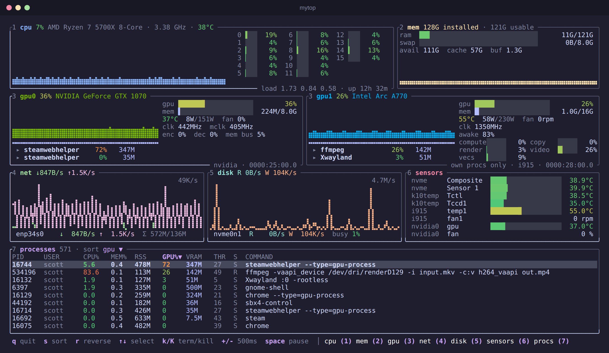

# mytop

A top-style terminal system monitor for Linux with live braille graphs for
**CPU, memory, GPU, network, disk I/O and hardware sensors**, plus a process
table showing **per-process GPU usage**. NVIDIA, Intel and AMD GPUs are
supported side by side.

[](https://github.com/scott-hiemstra/mytop/releases)
[](LICENSE)



## Features

- **CPU**: total-usage history graph, a bar per core, model, average clock,
  package temperature, load average, uptime.
- **Memory**: RAM and swap bars with history; shows installed RAM next to
  what the kernel can actually use.
- **GPU**, one panel per device, any mix of vendors:
  utilisation and VRAM graphs, temperature, power vs. limit, core/memory
  clocks, fan, video encode/decode or per-engine bars, and the two heaviest
  GPU processes.
- **Network**: rx/tx graph with auto-scaling, per-interface rates and totals.
- **Disk I/O**: read/write graph, per-disk rates and busy %.
- **Sensors**: every hwmon temperature and fan (CPU, NVMe, GPUs, motherboard
  Super-I/O chips) plus NVIDIA's sensors via NVML.
- **Processes**: sortable by CPU, memory, GPU, PID or name, with per-process
  GPU % and VRAM; send SIGTERM/SIGKILL with confirmation.
- Panels can be toggled to fit small terminals; layout adapts down to ~30×8.
- Low overhead: about 3% of one core at a 1 s refresh on a 16-thread desktop
  with two GPUs and ~550 processes.

## Install

Download the package for your distribution from the
[latest release](https://github.com/scott-hiemstra/mytop/releases/latest).
All packages are for x86_64.

**RHEL / Rocky / Alma / Fedora** (RHEL 8 or newer)

```sh
sudo dnf install ./mytop-0.1.0-1.x86_64.rpm
```

**Debian / Ubuntu** (Debian 10+, Ubuntu 20.04+)

```sh
sudo apt install ./mytop_0.1.0-1_amd64.deb
```

**Arch Linux**

```sh
sudo pacman -U mytop-0.1.0-1-x86_64.pkg.tar.zst
```

The release also contains the `PKGBUILD` used to build it, if you prefer to
build the package yourself with `makepkg -si`.

**Any distribution** (glibc 2.28+): the `mytop-<version>-x86_64-linux-gnu.tar.gz`
tarball contains the binary, man page, README and licence.

```sh
tar xf mytop-0.1.0-x86_64-linux-gnu.tar.gz
sudo install -m755 mytop-0.1.0/mytop /usr/local/bin/
```

**From source** (Rust 1.85 or newer):

```sh
cargo install --git https://github.com/scott-hiemstra/mytop
```

No GPU libraries are needed at build time. NVIDIA support is enabled
automatically when the proprietary driver's `libnvidia-ml.so.1` is present.

## Usage

```
mytop                 # 1 s refresh
mytop -i 500          # 500 ms refresh
mytop --bench         # time each collector and exit
sudo mytop            # also see other users' GPU processes (Intel/AMD)
man mytop
```

### Keys

| Key | Action |
|---|---|
| `q` `Esc` `Ctrl-C` | quit |
| `s` / `r` | cycle sort column / reverse order |
| `c` `m` `g` `p` `n` | sort by CPU / memory / GPU / PID / name |
| `↑` `↓` `PgUp` `PgDn` `Home` `End` | move the process selection |
| `k` / `K` | SIGTERM / SIGKILL the selected process (asks y/n) |
| `+` / `-` | refresh interval ±250 ms |
| `space` | pause / resume |
| `1`–`7` | show/hide the cpu, mem, gpu, net, disk, sensors, procs panels |

## Reading the panels

| Field | Meaning |
|---|---|
| cpu `%` | busy time across all cores (user + system + irq + steal) |
| core bars | per-logical-CPU busy %, numbered as in `/proc/stat` |
| mem `installed` / `usable` | RAM in the firmware memory map vs. the kernel's `MemTotal` (the difference is firmware, crashkernel and kernel page tables) |
| mem `avail` | `MemAvailable`: what can be allocated without swapping |
| gpu `%` | NVIDIA/AMD: driver-reported utilisation. Intel: the busiest engine |
| gpu `mem` | VRAM used / total |
| `awake` (Intel) | share of time the GPU was out of its RC6 sleep state, device-wide |
| `mem bus` | memory-controller utilisation (NVIDIA, AMD) |
| engine bars | per-engine busy % from DRM fdinfo (Intel/AMD) |
| net `Σ` | bytes received / sent since boot |
| disk `busy` | share of time the device had I/O in flight |
| process `CPU%` | per core, so a busy multi-threaded process can exceed 100 |
| process `GPU%` | NVIDIA: SM utilisation; Intel/AMD: busiest engine for that process |

The network header totals count physical NICs only, so traffic through
bridges and container veths isn't counted twice.

## Hardware support

| | Device stats | Per-process / per-engine | Status |
|---|---|---|---|
| NVIDIA (proprietary driver) | NVML | NVML | tested (GTX 1070) |
| Intel i915 (Arc, Xe, older iGPUs) | sysfs, hwmon, i915 ioctl | DRM fdinfo | tested (Arc A770) |
| Intel xe (Lunar Lake, Battlemage) | sysfs, hwmon | DRM fdinfo | implemented, untested |
| AMD amdgpu | sysfs, hwmon | DRM fdinfo | implemented, untested |
| NVIDIA nouveau | — | — | not supported |

Reports from AMD and xe users are very welcome; please open an issue.

## Permissions

mytop runs as a normal user. Some data needs more access:

- **Intel/AMD per-process GPU usage** is read from `/proc/<pid>/fdinfo`, which
  is only readable for your own processes. Run as root to see everyone's. The
  GPU panel shows "own procs only" when this applies.
- **Intel VRAM used** from the i915 query needs `CAP_PERFMON` (root). Without
  it, VRAM used is the sum of the visible processes.
- **Intel VRAM total** needs read/write access to `/dev/dri/renderD*`
  (the `render` group, which desktop users normally belong to).

## Troubleshooting

**No NVIDIA panel / "NVML unavailable".** Install the proprietary driver
(`nvidia-utils` on Arch, `nvidia-driver-*` on Ubuntu, `nvidia-driver-cuda-libs`
or `xorg-x11-drv-nvidia-cuda-libs` on RHEL/Fedora) and check that
`nvidia-smi` works.

**Sensors only show CPU, NVMe and GPU.** Motherboard temperatures and the
CPU/case fans need a Super-I/O driver. Run `sudo sensors-detect` (from
`lm-sensors`) or try `sudo modprobe nct6775` (most MSI, ASUS and ASRock
boards) or `it87` (many Gigabyte boards).

**Intel clock shows 0 MHz.** That's correct: the GPU is idle in RC6 and its
clock is gated.

**Intel GPU % is 0 but `awake` isn't.** Another user's process (or the
kernel) is using the GPU and you aren't root, so its fdinfo isn't visible.

**Characters look wrong.** Use a UTF-8 locale and a font with braille and
block-element glyphs (most modern terminal fonts have them).

## Building

```sh
cargo build --release          # binary in target/release/mytop
cargo clippy --release
cargo fmt
./target/release/mytop --bench
```

See [docs/ARCHITECTURE.md](docs/ARCHITECTURE.md) for how the code is laid
out and how each metric is computed, and
[CONTRIBUTING.md](CONTRIBUTING.md) for the release process.

## License

[MIT](LICENSE)
